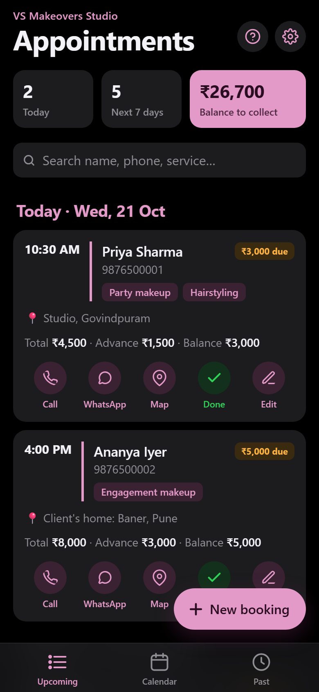

<div align="center">

# VS Appointments

**A simple, offline booking app for a makeup studio.**

Installs on an iPhone's home screen like a native app. No login, no server,
no monthly cost: bookings live on the phone.

[**Open the app**](https://azuresky0.github.io/vs-appointments/) ·
[Set it up on an iPhone](#set-it-up-on-an-iphone) ·
[Run the tests](#development-and-testing)

<br>



<sub>Screenshot with demo data.</sub>

</div>

---

## Why

A busy makeup artist books clients by phone and WhatsApp, often for
weddings at different venues. Paper diaries and chat threads make it easy to
double-book, forget an advance payment or lose a client's address. This app
puts every booking, payment and location in one place on her phone, and works
even without signal at a venue.

## Features

**Bookings**
- Client name and phone, date and time, place (studio, client's home, or a
  venue with its address), services, total and advance amounts, and notes.
- **Returning clients:** pick a past client and their phone number fills in.
- **Double-booking warning** when a new booking is within two hours of another
  that day.

**Seeing the day and week**
- **Upcoming list** grouped by day (Today, Tomorrow, …). Past bookings that were
  never marked done stay at the top, so none are missed.
- **Calendar** month view with the number of bookings per day.
- **At a glance:** bookings today, bookings in the next 7 days, and the total
  balance still to collect.
- **Search** by name, phone, service or address.

**Payments**
- **Done asks about the balance:** marking a booking done when money is still
  due asks whether it was paid in full, in part, or will be collected later.
- **Balance to collect:** tap the balance box to see who still owes money and
  how much, split into "to collect now" (finished or past bookings) and
  "upcoming". Each person has **Received**, **Remind** (a polite WhatsApp
  payment reminder) and **Call** buttons.
- Finished bookings that still owe show a "₹ due" badge and a **Received**
  button.

**One tap from each booking**
- **Call** the client, send a **WhatsApp** reminder (message pre-filled and
  editable in Settings), open the address in **Maps**, mark it **Done**, or
  **Edit** it.

**Keeping data safe**
- **Backup** to WhatsApp, Files, Drive or Mail through the iPhone share sheet,
  and **restore** from it. **Export to CSV** for Excel.
- A reminder appears if there has been no backup for 7 days.
- Damaged records are skipped and set aside instead of breaking the app.

## How it works

| | |
|---|---|
| **App** | A single-page web app in plain HTML, CSS and JavaScript (`index.html`), with no frameworks or build step |
| **Offline** | A service worker (`sw.js`) caches the app, so it opens with no connection, or even if the website is down |
| **Installable** | A web app manifest and icons let it be added to the home screen as a full-screen app |
| **Storage** | Bookings and settings are stored in the browser's local storage on the phone |
| **Hosting** | Any static host; this one runs on GitHub Pages |

## Set it up on an iPhone

1. Open **https://azuresky0.github.io/vs-appointments/** in **Safari** (not
   Chrome or an in-app browser).
2. Tap **Share → Add to Home Screen → Add**.
3. **Always open it from the home-screen icon.** The installed app keeps its
   own data, separate from Safari tabs, and Safari can clear data in a tab
   after 7 days without use.
4. Once a week, tap ⚙️ → **Save backup file** and send it to yourself on
   WhatsApp, or save it to Files or iCloud.

## Your data

- Bookings are stored **only on the phone**. Deleting the app or resetting the
  phone without a backup loses them. To restore, tap ⚙️ → **Restore from
  backup file**.
- Restoring **adds** the bookings from the file to those on the phone; every
  record is checked first, and damaged ones are skipped and counted.
- Nothing is sent to any server. There is no syncing between devices.

## Development and testing

Everything is static; open `index.html` through any local web server to work
on it.

```bash
python tests/run_tests.py
```

The end-to-end suite runs about 210 checks in headless Edge (or Chrome) at
iPhone width, including offline behaviour when the site is unreachable or the
network is slow. Release only when it prints **ALL PASSED**. The test page
erases app data, so it refuses to run anywhere except `localhost`.

**Releasing a change:** update `VERSION` in `sw.js` whenever any file changes,
so installed copies pick up the new version.

| File | Purpose |
|---|---|
| `index.html` | The whole app |
| `sw.js` | Offline support (bump `VERSION` on every release) |
| `manifest.webmanifest` | App name and icons for the home screen |
| `apple-touch-icon.png`, `icon-192.png`, `icon-512.png` | App icons |
| `tests/` | End-to-end tests (`tests.html`) and their runner (`run_tests.py`) |
| `docs/screenshot.png` | Screenshot for this page |

## Possible next steps

- Syncing between devices (for a second phone or an assistant) with a small
  cloud database such as Firebase or Supabase.

---

Built by [Akshat Sahu](https://github.com/AzureSky0) for VS Makeovers Studio.
